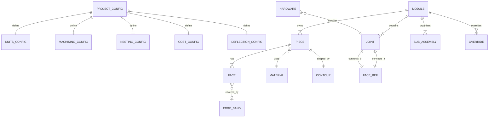
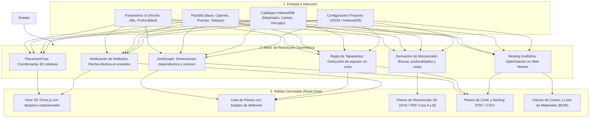

# Estructura de Datos de Mobilius

Este documento describe en detalle la arquitectura y las estructuras de datos que sustentan el funcionamiento de **Mobilius**.

---

## 1. Principios de Diseño de los Datos

1. **El Modelo es la Única Fuente de Verdad (*Single Source of Truth - SSOT*):**
   Todas las salidas (lista de corte, plano de sierra, presupuestos, visor 3D, planos de mecanizado 2D/PDF y comprobaciones estructurales) se derivan estrictamente de los datos resueltos. Ninguna salida se edita manualmente.
2. **Validación en Runtime y Tipado Estático:**
   Cada contrato de datos se define mediante esquemas de **Zod** (`src/model/`) que garantizan la integridad de los datos importados o almacenados. Los tipos TypeScript se infieren directamente de estos esquemas (`z.infer<typeof schema>`).
3. **Versionado de Esquemas (`schemaVersion`):**
   Todas las entidades almacenadas o exportadas poseen un campo entero `schemaVersion`, permitiendo migraciones limpias entre versiones sin pérdida de datos.
4. **Cero Constantes en Código:**
   Los tableros, tapacantos, herrajes y configuraciones de taller residen en **IndexedDB** y en archivos de configuración **JSON** por proyecto.
5. **Marcador de Verificación `TO_CONFIRM`:**
   Los valores de taller que no han sido validados por el carpintero de dominio utilizan el tipo unión `number | 'TO_CONFIRM'`, impidiendo la invención arbitraria de tolerancias o precios.

---

## 2. Diagrama Entidad-Relación (ERD)



---

## 3. Capa de Modelos de Dominio (`src/model/`)

### 3.1. Primitivas Comunes (`src/model/common.ts`)

```typescript
// Valor de taller no confirmado
export const TO_CONFIRM = 'TO_CONFIRM' as const;
export type ShopValue = number | 'TO_CONFIRM';

// Capacidad de mecanizado
export type Capability = 'yes' | 'no' | 'with-accessory';

// Punto geométrico 2D (mm)
export interface Point2D {
  x: number;
  y: number;
}

// Contorno 2D de una pieza con perforaciones interiores opcionales
export interface Contour {
  points: Point2D[];        // Mínimo 3 vértices (polígono cerrado)
  holes?: Point2D[][];      // Perforaciones o calados interiores
}

// Intervalo 1D a lo largo de una cara o arista (mm)
export interface Interval {
  start: number;
  end: number;
}

// Referencia unívoca a una cara de una pieza
export interface FaceRef {
  pieceId: string;
  faceId: string;
}
```

---

### 3.2. Catálogo de Materiales / Tableros (`src/model/material.ts`)

Representa las placas de melamina, aglomerado o MDF disponibles en taller.

```typescript
export interface MillingTolerance {
  hidden: 'yes' | 'no';                    // Admite fresado en cara oculta
  visible: Capability;                     // Admite fresado en cara visible
  onStructuralPiece: 'yes' | 'no' | 'limited'; // En pieza estructural
  maxDepthMm?: ShopValue;                  // Profundidad máxima segura (TO_CONFIRM)
}

export interface SheetSize {
  length: number | 'TO_CONFIRM';           // Largo de placa bruta en mm (ej. 2800)
  width: number | 'TO_CONFIRM';            // Ancho de placa bruta en mm (ej. 2070)
}

export interface Material {
  schemaVersion?: number;
  id: string;                              // Identificador único (ej. "mat-egger-white-18")
  name: string;                            // Nombre comercial
  thicknessMm: number | 'TO_CONFIRM';      // Espesor nominal en mm (ej. 18)
  sheetSizeMm: SheetSize;                  // Dimensiones comerciales de la placa
  hasGrain: boolean;                       // true: veta longitudinal obligatoria
  milling: MillingTolerance;               // Reglas de mecanizado
  heatResistant?: boolean;                 // Apto para nicho de horno/calor
  elasticModulusMPa?: ShopValue;           // Módulo de Young en MPa (TO_CONFIRM)
  pricePerSheet?: ShopValue;               // Precio de costo de la placa entera
}
```

---

### 3.3. Catálogo de Tapacantos (`src/model/edgeBand.ts`)

Define las cintas de borde aplicables a los cantos de las piezas.

```typescript
export type EdgeBandKind = 'adhesive' | 'aluminium-profile' | 'veneer' | 'rod';

export interface EdgeBand {
  schemaVersion?: number;
  id: string;                              // Identificador único (ej. "eb-white-08")
  kind: EdgeBandKind;                      // Tipo de canto
  thicknessMm: number | 'TO_CONFIRM';      // Espesor real que descuenta en corte (ej. 0.8, 2.0)
  pricePerMeter: ShopValue;                // Costo por metro lineal
  needsGroove?: boolean;                   // Si requiere ranura previa de inserción
}
```

---

### 3.4. Catálogo de Herrajes (`src/model/hardware.ts`)

Elementos mecánicos de ensamble o vinculación.

```typescript
export interface Hardware {
  schemaVersion?: number;
  id: string;                              // Identificador único (ej. "hw-confirmat-7x50")
  name: string;                            // Nombre descriptivo
  jointKind: string;                       // Tipo de ensamble asociado (ej. "confirmat")
  pricePerUnit: ShopValue;                 // Costo unitario
}
```

---

### 3.5. Piezas y Caras (`src/model/piece.ts`)

Una pieza es un panel único perteneciente a un módulo.

```typescript
export interface Face {
  id: string;                              // Rol de la cara (ej. "left-edge", "front-edge", "inner", "outer")
  visible: boolean;                        // Si es visible una vez armado el mueble
  edgeBandId?: string;                     // ID del tapacanto aplicado en este borde
}

export interface Piece {
  id: string;                              // ID estable (ej. "base-side-left", "shelf-1")
  role: string;                            // Rol funcional (side-left, bottom, shelf, back, door, etc.)
  materialId: string;                      // Vinculación al material
  contour: Contour;                        // Polígono 2D terminado
  thicknessMm: number;                     // Espesor del tablero
  faces: Face[];                           // Las 2 caras grandes (A y B) y sus bordes
  structural: boolean;                     // true: soporta carga o rigidiza el cajón
  referenceFace: 'A' | 'B';                // Cara de referencia apoyada en la mesa de mecanizado
}
```

---

### 3.6. Ensambles / Uniones (`src/model/joint.ts`)

Vinculan físicamente una cara de una pieza con la cara de otra pieza.

```typescript
export type JointKind =
  | 'dowel'         // Tarugo de madera
  | 'cam-dowel'     // Perno y caja excéntrica (Minifix / Rastex)
  | 'confirmat'     // Tornillo Confirmat
  | 'rebate'        // Rebajo / galce
  | 'groove'        // Ranura para fondo
  | 'glue'          // Encolado directo
  | 'butt'          // A tope simple
  | 'hinge'         // Bisagra cazoleta
  | 'slide'         // Corredera de cajón
  | 'shelf-pin';    // Pituto / perno de soporte de estante

export interface Joint {
  a: FaceRef;                              // Cara de la primera pieza
  b: FaceRef;                              // Cara de la segunda pieza
  kind: JointKind;                         // Tipo de unión
  offsetMm?: number;                       // Posición o retranqueo específico
  region?: Interval;                       // Tramo de contacto
}
```

---

### 3.7. Módulo, Sub-ensambles y Sobreescrituras (`src/model/module.ts`)

El módulo es la unidad raíz que es dueña de sus piezas y uniones.

```typescript
export interface SubAssembly {
  id: string;                              // ID del sub-conjunto (ej. "drawer-box-0")
  templateId: string;                      // Plantilla origen (ej. "drawer", "door")
  parameters: Record<string, number>;      // Parámetros propios del sub-conjunto
  pieceIds: string[];                      // Piezas que le pertenecen
}

export interface Override {
  pieceId: string;                         // Pieza modificada manualmente
  property: string;                        // Propiedad sobreescrita (ancho, espesor, etc.)
  value: number | string | boolean;
}

export interface Module {
  schemaVersion: number;                   // Versión del contrato (actualmente 1)
  id: string;                              // Identificador del módulo
  parameters: Record<string, number>;      // { width, height, depth }
  rootPieceId: string;                     // Pieza raíz del árbol de posicionamiento
  pieces: Piece[];                         // Piezas del módulo
  joints: Joint[];                         // Uniones entre piezas
  subAssemblies: SubAssembly[];            // Sub-ensambles generados
  overrides: Record<string, Override>;     // Modificaciones manuales del usuario
}
```

---

### 3.8. Configuración por Proyecto (`src/model/projectConfig.ts`)

Agrupa todos los parámetros de taller, sierra, costos y deflexión sin hardcodear.

```typescript
export interface UnitsConfig {
  length: 'mm' | 'cm' | 'm';
  currency: string;                        // ej. "ARS", "USD", "EUR"
}

export interface MachiningConfig {
  // Tornillos Confirmat
  confirmatThroughDiameterMm: number;      // ej. 7.0 mm (agujero pasante)
  confirmatCoreDiameterMm: number;         // ej. 5.0 mm (agujero guía)
  confirmatCoreDepthMm: number;            // ej. 50.0 mm
  // Cajas Minifix / Rastex
  minifixPocketDiameterMm: number;         // ej. 15.0 mm
  minifixPocketDepthMm: number;            // ej. 12.5 mm
  minifixPocketSetbackMm: number;          // ej. 34.0 mm
  minifixBoltDiameterMm: number;           // ej. 8.0 mm
  minifixDowelDiameterMm: number;          // ej. 8.0 mm
  minifixDowelDepthMm: number;             // ej. 30.0 mm
  // Tarugos de madera
  dowelFaceDiameterMm: number;             // ej. 8.0 mm
  dowelFaceDepthMm: number;                // ej. 12.0 mm
  dowelEdgeDiameterMm: number;             // ej. 8.0 mm
  dowelEdgeDepthMm: number;                // ej. 25.0 mm
  // Bisagras Euro
  hingeCupDiameterMm: number;              // ej. 35.0 mm
  hingeCupDepthMm: number;                 // ej. 11.5 mm
  hingeCupEdgeSetbackMm: number;           // ej. 5.0 mm
  hingePlateSetbackMm: number;             // ej. 37.0 mm (Sistema 32)
  hingePlateDiameterMm: number;            // ej. 5.0 mm
  hingePlateDepthMm: number;               // ej. 12.0 mm
  // Estantes y Sistema 32
  shelfPinDiameterMm: number;              // ej. 5.0 mm
  shelfPinDepthMm: number;                 // ej. 12.0 mm
  system32FrontSetbackMm: number;          // ej. 37.0 mm
  jointDrillMarginMm: number;              // ej. 50.0 mm (margen a extremos)
  maxSpanWithoutCenterDrillMm: number;     // ej. 500.0 mm (vano máximo sin tercer perno)
}

export interface NestingConfig {
  sawKerfMm: number;                       // Espesor del disco de corte (ej. 3.2 mm)
  sheetTrimMarginMm: number;               // Margen de refilado perimetral (ej. 10.0 mm)
  respectGrain: boolean;                   // Obligar corte longitudinal si hasGrain=true
}

export interface CostConfig {
  wasteFactorPercent: number;              // Porcentaje de desperdicio estimado (ej. 10%)
  hourlyLaborRate: number;                 // Tarifa horaria de mano de obra
}

export interface DeflectionConfig {
  maxDeflectionRatio: number;              // Relación admisible L / ratio (ej. 200 para L/200)
  maxAbsoluteDeflectionMm: number;         // Flecha absoluta máxima (ej. 3.0 mm)
  designUniformLoadKgM2: number;           // Carga de diseño distribuida (ej. 30.0 kg/m²)
}

export interface ProjectConfig {
  schemaVersion: 1;
  projectId: string;                       // Clave primaria en IndexedDB
  projectName: string;
  clientName: string;
  description: string;
  units: UnitsConfig;
  machining: MachiningConfig;
  nesting: NestingConfig;
  cost: CostConfig;
  deflection: DeflectionConfig;
}
```

---

## 4. Estructuras de la Capa de Resolución (`src/resolver/`)

### 4.1. Posicionamiento Espacial y Árbol de Piezas (`src/resolver/tree.ts`)

```typescript
export interface Position3D {
  x: number;
  y: number;
  z: number;
}

export interface PlacementNode {
  pieceId: string;
  parentPieceId: string | null;            // null si es la pieza raíz
  relativeOffset: Position3D;              // Desplazamiento respecto al origen del padre
}
```

---

### 4.2. Pieza Resuelta con Medida de Corte (`src/resolver/edgeBand.ts`)

Añade a la pieza las dimensiones de corte que descuentan los tapacantos.

```typescript
export interface BandedEdgeInfo {
  faceId: string;                          // ej. "front-edge", "left-edge"
  edgeBandId: string;                      // ID del tapacanto
  thicknessMm: number;                     // Espesor que descuenta
  lengthMm: number;                        // Largo lineal del canto
}

export interface ResolvedPiece extends Piece {
  positionMm: Position3D;                  // Coordenadas absolutas resueltas
  dimensionsMm: { width: number; height: number }; // Medida terminada
}

export interface ResolvedPieceWithCutSize extends ResolvedPiece {
  cutDimensionsMm: { width: number; height: number }; // Medida de corte en sierra
  cutContour: Contour;                     // Contorno reducido
  bandedEdges: BandedEdgeInfo[];           // Detalle de cantos aplicados
}
```

---

### 4.3. Cajas Tridimensionales y Despiece Explosionado (`src/resolver/spatial3d.ts`)

```typescript
export interface SpatialPieceBox {
  pieceId: string;
  role: string;
  materialId: string;
  thicknessMm: number;
  positionMm: Position3D;                  // Vértice mínimo en el espacio 3D
  sizeMm: Position3D;                      // Dimensiones (X=ancho, Y=alto, Z=profundidad)
  centerMm: Position3D;                    // Centro geométrico
}

export interface ModuleSpatialBounds {
  min: Position3D;
  max: Position3D;
  center: Position3D;
  size: Position3D;
}

export interface ExplodedPieceBox extends SpatialPieceBox {
  explodedPositionMm: Position3D;          // Posición desplazada según el ratio de explosión
  explodedOffsetMm: Position3D;            // Vector de desplazamiento aplicado
}
```

---

### 4.4. Operaciones de Mecanizado Derivadas (`src/resolver/machining.ts`)

Perforaciones calculadas automáticamente a partir de los ensambles:

```typescript
export interface DrillOperation {
  id: string;                              // Identificador único de la perforación
  pieceId: string;                         // Pieza a taladrar
  faceType: 'face-A' | 'face-B' | 'edge';  // Cara A (superior), Cara B (inferior) o canto
  faceId: string;                          // Identificador de la cara
  diameterMm: number;                      // Diámetro de la broca
  depthMm: number;                         // Profundidad del taladro
  isThrough: boolean;                      // true si atraviesa completamente el espesor
  positionMm: { x: number; y: number };    // Coordenadas en el plano local de la cara
  sourceJointKind: JointKind;              // Origen (confirmat, hinge, shelf-pin, etc.)
  description: string;                     // Descripción legible para el operario
}

export interface PieceMachining {
  pieceId: string;
  role: string;
  materialId: string;
  operations: DrillOperation[];            // Todas las operaciones agrupadas por pieza
}
```

---

### 4.5. Plano de Mecanizado 2D de Taller (`src/resolver/machiningSheet.ts`)

Estructura optimizada para generar las cotas en SVG y PDF para el operario:

```typescript
export interface SheetOperationItem {
  id: string;
  faceType: 'face-A' | 'face-B';
  faceId: string;
  diameterMm: number;
  depthMm: number;
  isThrough: boolean;
  xMm: number;
  yMm: number;
  distFromLeftMm: number;                  // Cota acotada desde el canto izquierdo
  distFromBottomMm: number;                // Cota acotada desde el canto inferior
  distFromRightMm: number;                 // Cota desde el canto derecho
  distFromTopMm: number;                   // Cota desde el canto superior
  description: string;
  sourceJointKind: JointKind;
}

export interface PieceMachiningSheet {
  pieceId: string;
  role: string;
  materialId: string;
  dimensionsMm: { width: number; height: number; thickness: number };
  cutDimensionsMm: { width: number; height: number };
  bandedEdges: { top: boolean; bottom: boolean; left: boolean; right: boolean };
  faceAOperations: SheetOperationItem[];   // Operaciones en cara superior
  faceBOperations: SheetOperationItem[];   // Operaciones en cara inferior (requiere dar vuelta)
}
```

---

### 4.6. Cálculo y Análisis de Deflexión (`src/resolver/deflection.ts`)

```typescript
export interface ShelfDeflectionInput {
  spanMm: number;                          // L: vano libre entre laterales
  depthMm: number;                         // D: profundidad del estante
  thicknessMm: number;                     // T: espesor del tablero
  elasticModulusMPa?: number | 'TO_CONFIRM'; // Módulo E del material
  designUniformLoadKgM2?: number;          // Carga distribuida (ej. 30 kg/m²)
  maxDeflectionRatio?: number;             // Relación admisible L / ratio (ej. 200)
  maxAbsoluteDeflectionMm?: number;        // Flecha máxima admisible (ej. 3 mm)
}

export interface ShelfDeflectionResult {
  spanMm: number;
  depthMm: number;
  thicknessMm: number;
  elasticModulusMPa: number;               // Módulo utilizado (efectivo o default 3000 MPa)
  isElasticModulusConfirmed: boolean;      // false si provino de TO_CONFIRM
  totalLoadKg: number;                     // Carga total calculada en masa
  totalLoadN: number;                      // Fuerza total en Newtons
  inertiaMm4: number;                      // Inercia I = (D * T^3) / 12
  calculatedDeflectionMm: number;          // Flecha calculada mid-span (delta)
  allowableDeflectionMm: number;           // Flecha máxima admisible (delta_adm)
  deflectionRatio: number;                 // Relación real L / delta
  exceedsRatio: boolean;                   // true si delta > L / ratio
  exceedsAbsolute: boolean;                // true si delta > maxAbsolute
  hasWarning: boolean;                     // true si excede el límite
  warningMessage?: string;                 // Mensaje explicativo para el usuario
}
```

---

### 4.7. Lista de Materiales (BOM) y Presupuesto (`src/resolver/bom.ts`, `src/resolver/cost.ts`)

```typescript
export interface BOMPieceItem {
  pieceId: string;
  role: string;
  materialId: string;
  widthMm: number;
  heightMm: number;
  thicknessMm: number;
  areaM2: number;
}

export interface BOMEdgeBandItem {
  edgeBandId: string;
  totalLengthMeters: number;
}

export interface BOMHardwareItem {
  hardwareId: string;
  name: string;
  quantity: number;
}

export interface BillOfMaterials {
  moduleId: string;
  pieces: BOMPieceItem[];
  edgeBands: BOMEdgeBandItem[];
  hardware: BOMHardwareItem[];
  totalAreaM2: number;
  totalEdgeBandMeters: number;
}

export interface ModuleCostSummary {
  materialCost: number;                    // Placas brutas utilizadas
  edgeBandCost: number;                    // Metros de tapacanto
  hardwareCost: number;                    // Herrajes de ensamble
  laborCost: number;                       // Mano de obra de taller
  wasteCost: number;                       // Costo de merma/desperdicio
  totalCost: number;                       // Costo total estimado
}
```

---

## 5. Capa de Persistencia en IndexedDB (`src/storage/db.ts`)

La base de datos local del navegador se llama **`mobilius_db`** (versión 2) y cuenta con tres almacenes principales:

| Almacén (*Object Store*) | Clave Primaria (*keyPath*) | Estructura Almacenada | Descripción |
|---|---|---|---|
| `modules` | `id` | [`Module`](file:///home/federico@uba-ilse.com.ar/mobilius/src/model/module.ts#L40) | Diseños de módulos guardados por el usuario. |
| `catalogs` | `id` | `MaterialCatalog`, `EdgeBandCatalog`, `HardwareCatalog` | Catálogos de tableros, cantos y herrajes cargados en la aplicación. |
| `configs` | `projectId` | [`ProjectConfig`](file:///home/federico@uba-ilse.com.ar/mobilius/src/model/projectConfig.ts#L69) | Configuraciones de mecanizado, sierra, costos y deflexión por proyecto. |

Todas las entidades almacenadas cumplen con la interfaz base:
```typescript
export interface StoredEntity {
  id: string;
  schemaVersion: number;
}
```

---

## 6. Diagrama del Ciclo de Vida y Flujo de los Datos


