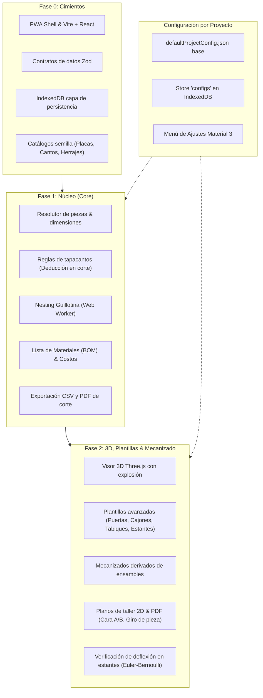

# Recorrido del Proyecto: CadCat (Walkthrough)

**CadCat** es una aplicación web progresiva (**PWA**) diseñada para carpinteros y fabricantes de muebles a medida a partir de tableros de madera (melamina, MDF, aglomerado, tableros Egger, etc.). Funciona de forma 100% autónoma en el navegador (**sin servidor**) y con soporte completo **offline** mediante IndexedDB y Service Workers.

---

## 1. Principios de Arquitectura y Diseño

El desarrollo del proyecto se rige por directrices estrictas:

1. **Patrón MVVM (Model - View - ViewModel):**
   - **Model (`src/model/` y `src/storage/`):** Datos estructurados validados en tiempo de ejecución con **Zod**, contratos de tipado e interacción con la base de datos local **IndexedDB**.
   - **ViewModel (`src/ui/useModuleViewModel.ts`):** Estado reactivo, orquestación de resolución de piezas, cómputo de listas de corte, cálculo de mecanizados, análisis de costos, persistencia y control de navegación.
   - **View (`src/ui/`):** Componentes React puramente visuales y declarativos, diseñados bajo las pautas de **Google Material Design 3 (M3)**.

2. **Cero constantes hardcodeadas en código de negocio:**
   - Precios, dimensiones de placas, espesores de cantos, holguras de herrajes y tolerancias residen en **base de datos (IndexedDB)** y en **archivos de configuración por proyecto (`.json`)**.
   - Todo valor de taller no confirmado por el carpintero de dominio se identifica explícitamente con `TO_CONFIRM` en [`docs/TO_CONFIRM.md`](file:///home/federico@uba-ilse.com.ar/mobilius/docs/TO_CONFIRM.md).

3. **Arquitectura en tres capas:**
   - **Intención:** Lo que el usuario parametriza (dimensiones exteriores, plantilla elegida, material, cantos).
   - **Resolución:** El motor matemático que calcula piezas, dimensiones reales, ensambles y cotas de perforación (`src/resolver/`).
   - **Salidas:** El visor 3D, listas de corte optimizadas, planos de mecanizado 2D/PDF, presupuestos y despiece.

4. **Calidad de código y tipado:**
   - TypeScript en modo estricto (`strict: true`, `noUnusedLocals: true`, cero `any`).
   - 119 pruebas unitarias automatizadas con Vitest ejecutándose en 100% de éxito.

---

## 2. Mapa de Fases Desarrolladas



---

## 3. Detalle de lo Realizado hasta la Fecha

### 3.1. Fase 0: Cimientos (*Foundation*)
- **Estructura del Proyecto:** Configuración de Vite, React 19, TypeScript estricto y Vitest con `fake-indexeddb` y `jsdom`.
- **Soporte Offline PWA:** Integración de `vite-plugin-pwa` con Workbox precargando HTML, JS, CSS y assets con estrategia de actualización inmediata.
- **Capa de Persistencia IndexedDB ([`src/storage/db.ts`](file:///home/federico@uba-ilse.com.ar/mobilius/src/storage/db.ts)):** Base de datos `cadcat_db` con almacenes para `materials`, `edgeBands`, `hardware`, `modules` y `configs`.
- **Modelos y Schemas Zod ([`src/model/`](file:///home/federico@uba-ilse.com.ar/mobilius/src/model/index.ts)):** Validación rigurosa en runtime de entidades: `Material`, `EdgeBand`, `Hardware`, `Piece`, `Joint`, `Module`.
- **Catálogos Semilla ([`src/catalog/`](file:///home/federico@uba-ilse.com.ar/mobilius/src/catalog/index.ts)):** Carga inicial de tableros Egger (Blanco 18mm, Roble 18mm), tapacantos de PVC/ABS y herrajes típicos.

---

### 3.2. Fase 1: Núcleo de Corte y Presupuesto (*Core*)
- **Motor de Resolución Geométrica ([`src/resolver/resolver.ts`](file:///home/federico@uba-ilse.com.ar/mobilius/src/resolver/resolver.ts)):**
  - Árbol de posicionamiento relativo ([`PlacementTree`](file:///home/federico@uba-ilse.com.ar/mobilius/src/resolver/tree.ts)).
  - Grafo de ensambles de contacto ([`JointGraph`](file:///home/federico@uba-ilse.com.ar/mobilius/src/resolver/joint.ts)) para resolución de medidas dependientes con ordenación topológica y prevención de ciclos.
- **Regla Estricta de Tapacantos ([`src/resolver/edgeBand.ts`](file:///home/federico@uba-ilse.com.ar/mobilius/src/resolver/edgeBand.ts)):**
  - La medida de corte en sierra (*cut size*) descuenta automáticamente el espesor del tapacanto colocado en cada cara de borde, manteniendo la medida final requerida.
- **Optimización de Corte (Nesting Guillotina) en Web Worker ([`src/workers/guillotineNesting.ts`](file:///home/federico@uba-ilse.com.ar/mobilius/src/workers/guillotineNesting.ts)):**
  - Algoritmo de corte guillotina continuo para escuadradora / seccionadora.
  - Respeta el sentido de la veta del tablero (`hasGrain`), el ancho del disco de corte (`sawKerfMm`) y el margen perimetral de refilado (`sheetTrimMarginMm`).
- **Lista de Materiales (BOM) y Costos ([`src/resolver/bom.ts`](file:///home/federico@uba-ilse.com.ar/mobilius/src/resolver/bom.ts), [`src/resolver/cost.ts`](file:///home/federico@uba-ilse.com.ar/mobilius/src/resolver/cost.ts)):**
  - Cuantificación automática de metros lineales de canto, placas necesarias y cantidad de herrajes según el tipo de ensamble.
  - Estimación de costos de materia prima con margen de desperdicio y costo de mano de obra.
- **Exportaciones ([`src/resolver/export.ts`](file:///home/federico@uba-ilse.com.ar/mobilius/src/resolver/export.ts)):**
  - Exportación de la lista de corte a **CSV**.
  - Generación de informe de corte en **PDF** con `jspdf`.

---

### 3.3. Fase 2: Visualización 3D, Plantillas Avanzadas y Mecanizado

#### 1. Visor 3D y Vista Explosionada ([`src/ui/Viewport3D.tsx`](file:///home/federico@uba-ilse.com.ar/mobilius/src/ui/Viewport3D.tsx))
- Renderizado tridimensional en tiempo real con **Three.js**.
- Control orbital con ratón (rotación, traslación y zoom).
- Vistas de cámara predefinidas (Isométrica, Frente, Superior, Lateral).
- Modo alambre (*Wireframe*) e iluminación realista.
- **Despiece Explosionado Paramétrico ([`src/resolver/spatial3d.ts`](file:///home/federico@uba-ilse.com.ar/mobilius/src/resolver/spatial3d.ts)):**
  - Control deslizante de 0% a 100%.
  - Separación geométrica vectorial según el rol de la pieza (laterales hacia los costados en X, piso hacia abajo en Y, frente/puertas/cajones hacia adelante en -Z, fondo hacia atrás en +Z, etc.).
- **Inspección de Piezas:** Selección de pieza por clic (raycaster), resaltado en color primario M3 y panel lateral con medidas terminadas, de corte, posición 3D y análisis estructural.

#### 2. Catálogo de Plantillas Avanzadas ([`src/resolver/templates/`](file:///home/federico@uba-ilse.com.ar/mobilius/src/resolver/templates/index.ts))
- **Mueble Base Estándar (`baseCabinet`):** Laterales, piso, fajas de amarre superior, fondo ranurado y estante intermedio.
- **Módulo de Cajones (`drawerUnit`, `drawer`):** Cajones múltiples con cálculo de holguras según tipo de corredera (telescópicas estándar, ocultas bajo fondo, o metálicas de rodillos), alturas proporcionales de frentes y gaveta interior con fondo enrasado o ranurado.
- **Módulo de Puertas Batientes (`doorCabinet`, `door`):** Puertas simples o dobles con montaje solapado (*overlay*) o embutido (*inset*), cálculo industrial de cantidad de bisagras según altura y separación entre bisagras.
- **Módulo con Tabique Divisorio (`partitionCabinet`, `partition`):** Montante central que divide el vano y soporta estantes independientes a diferentes alturas.
- **Sub-ensamblaje de Estantes (`shelf`):** Estantes fijos con confirmat/minifix o regulables sobre pitutos/pernos de 5 mm con holgura lateral para montaje suave.

#### 3. Derivación Automática de Mecanizados ([`src/resolver/machining.ts`](file:///home/federico@uba-ilse.com.ar/mobilius/src/resolver/machining.ts))
- Transforma automáticamente los ensambles lógicos en perforaciones físicas de taller:
  - **Tornillo Confirmat:** Agujero pasante en la cara del lateral ($\varnothing 7\text{ mm}$) y agujero guía en el canto de la pieza testeada ($\varnothing 5\text{ mm}\times 50\text{ mm}$).
  - **Minifix / Rastex:** Alojamiento de caja en la cara interior ($\varnothing 15\text{ mm}\times 12.5\text{ mm}$, retranqueo a $34\text{ mm}$) y taladro pasante/guía en canto ($\varnothing 8\text{ mm}$).
  - **Tarugo de madera:** Taladro ciego en cara ($\varnothing 8\text{ mm}\times 12\text{ mm}$) y en canto ($\varnothing 8\text{ mm}\times 25\text{ mm}$).
  - **Bisagras Euro:** Cazoleta en puerta ($\varnothing 35\text{ mm}\times 11.5\text{ mm}$, distancia al borde $5\text{ mm}$) y base en lateral interior ($\varnothing 5\text{ mm}$, retranqueo a $37\text{ mm}$ del frente según Sistema 32).
  - **Soportes de estante regulable:** Perforaciones a $37\text{ mm}$ del frente y fondo ($\varnothing 5\text{ mm}\times 12\text{ mm}$).
- Distribución modular respetando márgenes de extremo y espaciados de paso para vanos mayores a $500\text{ mm}$.

#### 4. Ficha de Mecanizado 2D y PDF para Máquinas Manuales ([`src/resolver/machiningSheet.ts`](file:///home/federico@uba-ilse.com.ar/mobilius/src/resolver/machiningSheet.ts), [`src/ui/MachiningSheetView.tsx`](file:///home/federico@uba-ilse.com.ar/mobilius/src/ui/MachiningSheetView.tsx))
- Diseñado para carpinteros con taladro de columna, plantilla manual o escuadradora.
- Muestra el despiece pieza por pieza con selector de chips:
  - **Cara A (Arriba en la máquina):** Plano acotado en SVG con distancias referenciadas a los bordes de referencia (canto izquierdo y canto inferior).
  - **Cara B (Abajo en la máquina):** Con indicador visual destacado de advertencia: **"⚠️ ATENCIÓN: GIRAR LA PIEZA PARA MECANIZAR CARA B"**.
  - **Cantos aplicados:** Señalización gráfica de qué bordes llevan tapacanto y su espesor.
  - **Tabla de coordenadas:** Lista tabular de cada perforación con diámetro, profundidad, pasante/ciego y distancias exactas a los 4 bordes.
  - **Exportación en PDF:** Descarga de planos de mecanizado individuales o del juego completo del módulo.

#### 5. Verificación de Deflexión Elástica en Estantes ([`src/resolver/deflection.ts`](file:///home/federico@uba-ilse.com.ar/mobilius/src/resolver/deflection.ts))
- Cálculo analítico de flecha máxima en el centro del vano bajo carga uniforme:
  $$\delta = \frac{5 \cdot W \cdot L^3}{384 \cdot E \cdot I}$$
- Comprobación contra $\delta_{\text{adm}} = \min(L / \text{maxDeflectionRatio}, \text{maxAbsoluteDeflectionMm})$ (por defecto $L / 200$ o $3\text{ mm}$).
- **Aviso en la interfaz:**
  - En la **Lista de Piezas**, badge verde de conformidad o badge ámbar/rojo con advertencia cuando el estante es demasiado largo o delgado para la carga prevista.
  - En el **Visor 3D**, tarjeta técnica con la flecha calculada, límite admisible, carga total en kg y módulo de elasticidad utilizado.

---

### 3.4. Archivos de Configuración y Menú por Proyecto

Para dar cumplimiento estricto al requisito de que ninguna configuración resida fija en código:

1. **Archivo Base (`src/config/defaultProjectConfig.json`):**
   - Define los valores predeterminados de taller: diámetros y profundidades de brocas, retranqueos de herrajes, Sistema 32, espesor del disco de sierra, holguras de corte, márgenes de desperdicio, tarifa horaria y límites de deflexión.
2. **Persistencia en Base de Datos ([`src/storage/projectConfigStore.ts`](file:///home/federico@uba-ilse.com.ar/mobilius/src/storage/projectConfigStore.ts)):**
   - Almacén `'configs'` en IndexedDB que almacena las configuraciones editadas por proyecto.
   - En el inicio de la aplicación, carga los ajustes del proyecto; si no existen, inicializa a partir del JSON base.
3. **Menú de Configuración Material 3 ([`src/ui/ProjectSettingsView.tsx`](file:///home/federico@uba-ilse.com.ar/mobilius/src/ui/ProjectSettingsView.tsx)):**
   - Pestaña **⚙️ Configuración** con 4 secciones temáticas:
     - `🛠️ Mecanizado & Taller`: Diámetros, profundidades y cotas de confirmat, minifix, tarugos, bisagras y estantes.
     - `🪚 Sierra & Nesting`: Ancho de sierra, margen de refilado perimetral y respeto de veta.
     - `📋 Proyecto & Cliente`: Nombre del proyecto, cliente, moneda y unidades.
     - `📐 Deflexión & Costos`: Carga de diseño en $\text{kg/m}^2$, límites de flecha, desperdicio y costo de mano de obra.
   - Funcionalidades: **Guardar en Base de Datos**, **Exportar Configuración JSON**, **Importar Archivo JSON** y **Restablecer a Valores de Fábrica**.
   - Los cambios aplicados se reflejan inmediatamente en tiempo real en los planos de perforación y en el visor 3D.

---

## 4. Estructura de Archivos del Repositorio

```
mobilius/
├── PROJECT_PLAN.md                  # Plan maestro del proyecto en ASD-STE100
├── docs/
│   ├── DECISIONS.md                 # Registro de decisiones de arquitectura (ADRs 001 a 006)
│   ├── TO_CONFIRM.md                # Valores de taller a confirmar por el experto de dominio
│   └── IDEAS.md                     # Banco de ideas y mejoras futuras
├── src/
│   ├── config/
│   │   └── defaultProjectConfig.json # Configuración base de taller y proyecto
│   ├── model/                       # Esquemas y contratos de datos Zod
│   │   ├── common.ts, material.ts, edgeBand.ts, hardware.ts, piece.ts, joint.ts, module.ts
│   │   ├── projectConfig.ts         # Esquema de configuración de taller y proyecto
│   │   └── index.ts
│   ├── storage/                     # Capa IndexedDB
│   │   ├── db.ts                    # Wrapper transaccional tipado
│   │   ├── catalogStore.ts          # Carga y guardado de catálogos
│   │   ├── projectConfigStore.ts    # Persistencia, exportación e importación de configs
│   │   └── index.ts
│   ├── catalog/                     # Datos semilla
│   │   ├── materials.json, edgeBands.json, hardware.json
│   │   └── index.ts
│   ├── resolver/                    # Motor de cálculo matemático
│   │   ├── piece.ts, joint.ts, tree.ts, resolver.ts
│   │   ├── edgeBand.ts              # Regla de descuento de cantos en corte
│   │   ├── bom.ts, cost.ts, export.ts
│   │   ├── spatial3d.ts             # Bounding boxes 3D y vista explosionada
│   │   ├── machining.ts             # Derivación de perforaciones de ensambles
│   │   ├── machiningSheet.ts        # Planos de taller 2D/PDF (Cara A / Cara B)
│   │   ├── deflection.ts            # Cálculo de flecha en estantes (Euler-Bernoulli)
│   │   ├── templates/               # Plantillas de muebles y sub-ensambles
│   │   └── index.ts
│   ├── workers/
│   │   └── guillotineNesting.ts     # Algoritmo de corte guillotina en Web Worker
│   ├── ui/                          # Interfaz de usuario (React + Google Material 3)
│   │   ├── App.tsx                  # Componente raíz con navegación por pestañas M3
│   │   ├── useModuleViewModel.ts    # ViewModel central (MVVM)
│   │   ├── ModuleForm.tsx           # Formulario paramétrico de módulo
│   │   ├── Viewport3D.tsx           # Visor 3D Three.js con inspector lateral
│   │   ├── MachiningSheetView.tsx   # Visor de planos de mecanizado 2D
│   │   ├── PieceListView.tsx        # Lista de piezas con badges de deflexión
│   │   ├── ProjectSettingsView.tsx  # Menú de configuración por proyecto
│   │   └── theme.css                # Tokens de diseño y componentes Material 3
│   └── main.tsx
├── tests/                           # 22 suites de test (119 pruebas unitarias)
├── package.json
├── tsconfig.json
└── vite.config.ts
```

---

## 5. Estado de Pruebas y Compilación

- **Pruebas unitarias:** 119 pruebas ejecutándose con Vitest:
  ```bash
  npm test
  # Test Files  22 passed (22)
  # Tests       119 passed (119)
  ```
- **Compilación estricta y empaquetado PWA:**
  ```bash
  npm run build
  # tsc --noEmit && vite build
  # ✓ built in 5.3s - PWA Service Worker generado con Workbox
  ```

---

## 6. Próximos Pasos (Fase 3: Equipamiento y Elementos Externos)

Siguiendo la hoja de ruta de [`PROJECT_PLAN.md`](file:///home/federico@uba-ilse.com.ar/mobilius/PROJECT_PLAN.md#L329-L348), los siguientes desarrollos a encarar son:

1. **Nivel de Ensamble (*Ensemble Level*):**
   - Incorporación de la mesada / encimera (*countertop*) como elemento externo que reposa y se apoya sobre uno o más módulos contiguos.
2. **Reglas de Apoyo y Voladizo (*Overhang*):**
   - Cálculo de voladizos permitidos frontal y lateral según el material (piedra, granito, cuarzo, madera maciza, laminado).
   - Regla de peso propio por $\text{m}^2$ para materiales pesados y necesidad de refuerzo estructural.
3. **Catálogo de Equipamiento (*Equipment Catalog*):**
   - Definición de fregadero / bacha, horno bajo mesada y microondas con sus requisitos de instalación (tomas de agua, desagüe, gas, electricidad, ventilación).
4. **Calados y Volúmenes Reservados en el Mueble:**
   - Generación automática del calado en la mesada y reserva volumétrica que inhabilita o redimensiona cajones/estantes conflictivos.
   - Verificación de que el equipo no atraviese una unión estructural entre módulos sin soporte adecuado.
